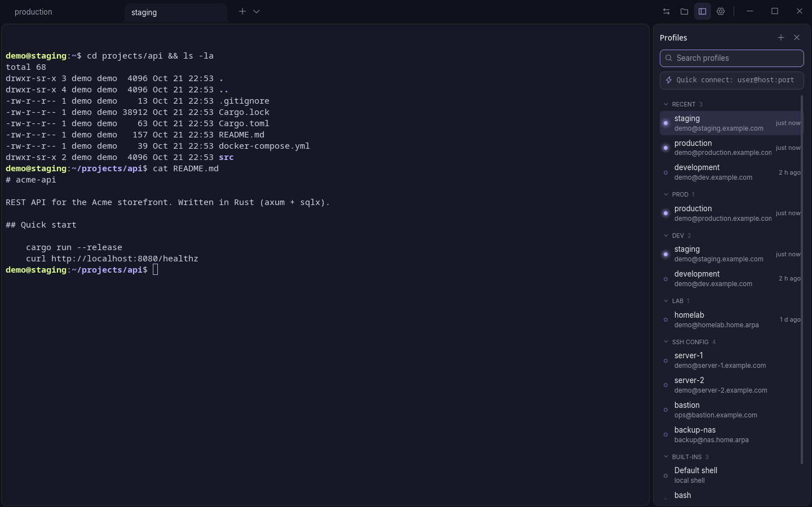
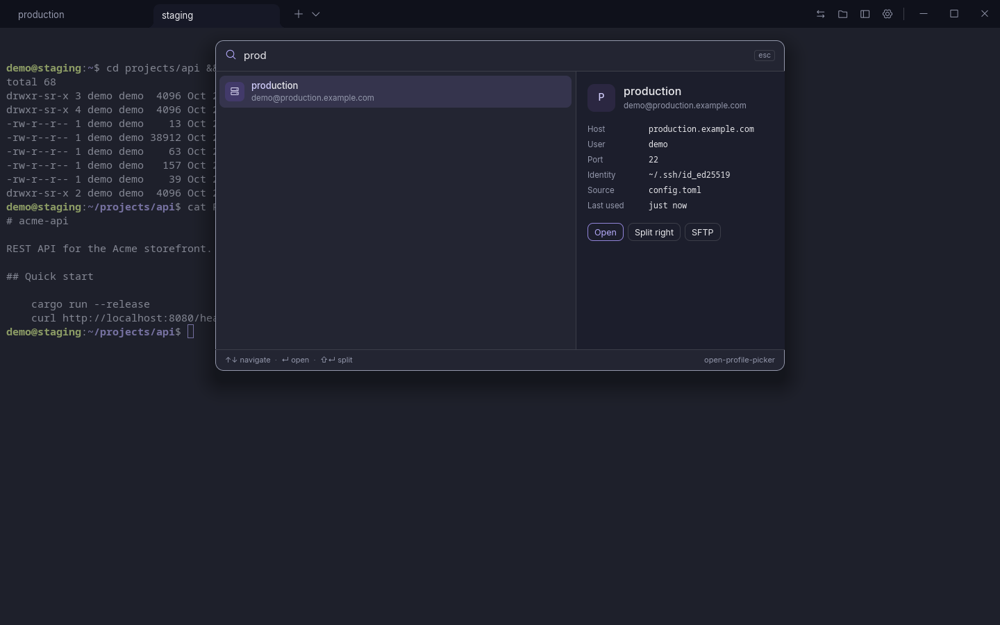
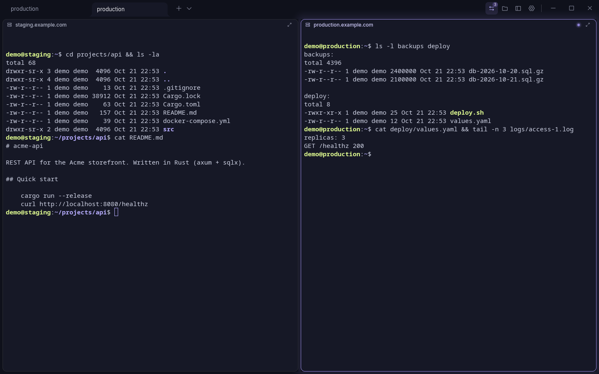
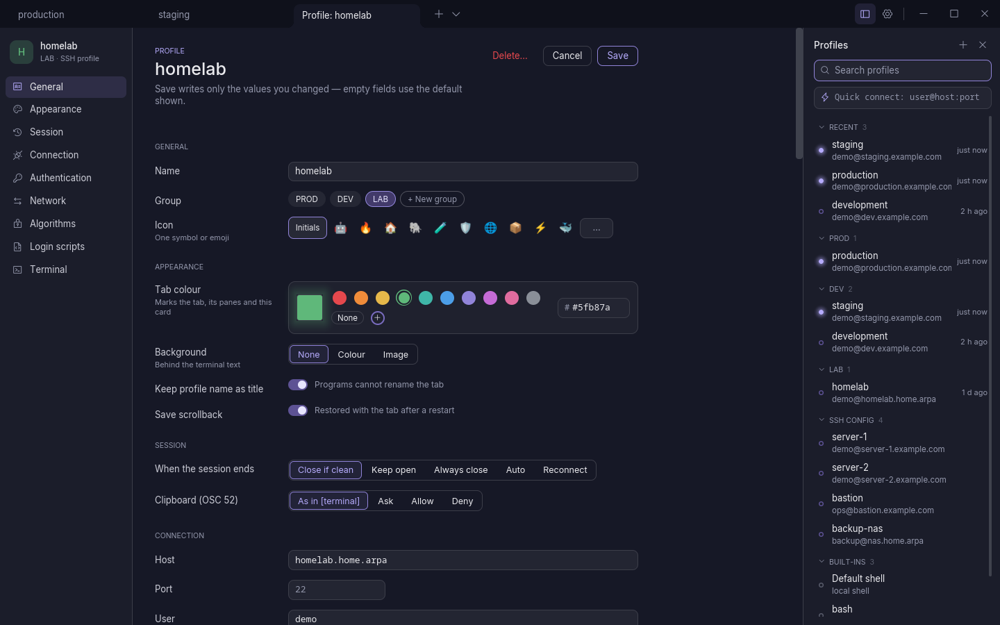
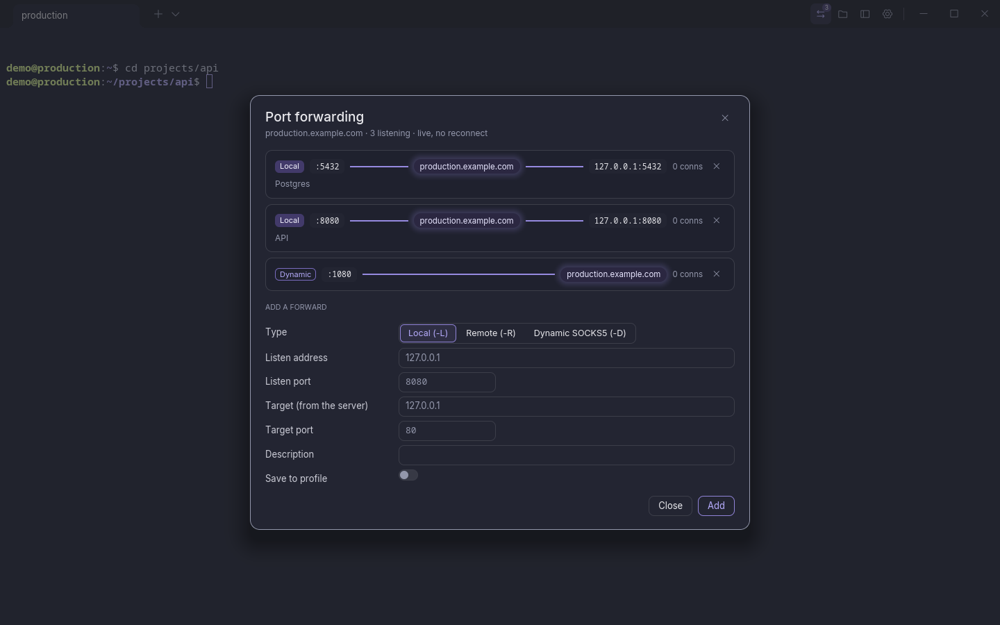
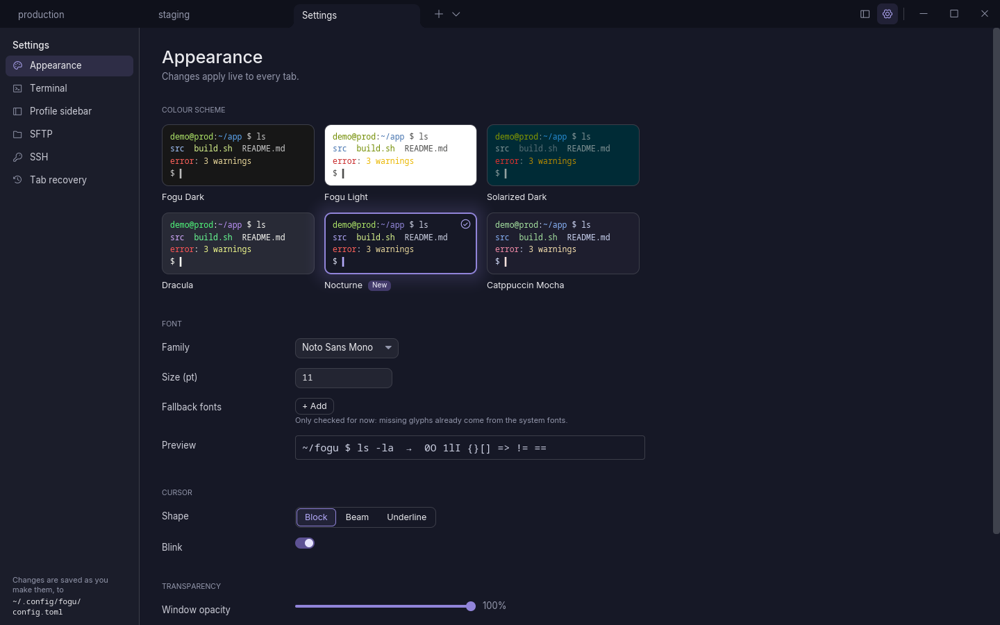

<p align="center">
  
</p>

<h1 align="center">Fogu Terminal</h1>

<p align="center">
  <strong>A native terminal with a built-in SSH manager and SFTP browser.</strong><br>
  Linux, macOS and Windows (alpha). Written in Rust, no browser engine.
</p>

<p align="center">
  
  
  
</p>

- [What it is](#what-it-is)
- [Install](#install)
  - [Linux](#linux) · [macOS](#macos) · [Windows](#windows-alpha)
  - [From source](#install-from-source): [Linux](#linux-from-source) · [macOS](#macos-from-source)
  - [Uninstall](#uninstall)
- [Features](#features)
- [Contributing and license](#contributing-and-license)
- [Optional updates](#optional-updates)

## What it is

A terminal for people who live on remote servers. Click a host in the sidebar and you are in a
shell; open the SFTP panel and you browse the same machine on the same connection, already in the
directory your shell is in. It reads your `~/.ssh/config`, keeps passwords in the system keyring
and starts in about a tenth of a second. *Fogu* means *fire* in Sardinian.

> **Beta:** used daily, but expect rough edges and config changes before 1.0.

<p align="center">
  
</p>

<details>
<summary><b>More screenshots</b></summary>

<p align="center">
  
</p>
<p align="center"><em>Profiles sidebar: groups, a dot on every live host, every host from <code>~/.ssh/config</code>.</em></p>

<p align="center">
  
</p>
<p align="center"><em>Quick picker (<code>Ctrl+Shift+E</code>): type a few letters, press Enter; Shift+Enter splits.</em></p>

<p align="center">
  
</p>
<p align="center"><em>SFTP panel on the same connection as the shell.</em></p>

<p align="center">
  
</p>
<p align="center"><em>Split panes, each on its own host; the focused one glows.</em></p>

<p align="center">
  
</p>
<p align="center"><em>Profile page: one scrolling page, only the values you change are written to <code>config.toml</code>.</em></p>

<p align="center">
  
</p>
<p align="center"><em>Port forwarding: local, remote and SOCKS5 routes, managed live.</em></p>

<p align="center">
  
</p>
<p align="center"><em>Settings (<code>Ctrl+,</code>): changes apply live to every tab.</em></p>

</details>

## Install
Prebuilt downloads come from the [Releases page](https://github.com/Revdep/Fogu/releases).

### Linux

Fogu needs `curl` (for this download and for its own updates) and the X11/Wayland keyboard,
cursor and input libraries. Desktop installs have them all; on a minimal system install them first:

```bash
# Debian, Ubuntu
sudo apt install curl libx11-6 libx11-xcb1 libxcb1 libxcursor1 libxi6 libxkbcommon0 libxkbcommon-x11-0 libwayland-client0
# Fedora, RHEL
sudo dnf install curl libX11 libX11-xcb libxcb libXcursor libXi libxkbcommon libxkbcommon-x11 libwayland-client
# Arch Linux
sudo pacman -S --needed curl libx11 libxcb libxcursor libxi libxkbcommon libxkbcommon-x11 wayland
```

Without a working GPU driver, start it with `fogu --software-render`.

Then:

```bash
curl -fsSL https://github.com/Revdep/Fogu/releases/latest/download/Fogu-linux-x86_64.tar.gz | tar xz
cd Fogu-linux-x86_64 && ./install.sh
```

Or the single-file AppImage:

```bash
curl -fsSLo Fogu.AppImage https://github.com/Revdep/Fogu/releases/latest/download/Fogu-x86_64.AppImage
chmod +x Fogu.AppImage && ./Fogu.AppImage
```

Needs glibc 2.28 or newer (Debian 10, Ubuntu 20.04, RHEL 8, Fedora, Arch Linux).

### macOS

`curl`, which Fogu also uses for its updates, comes with macOS.

Apple Silicon (M1 and later):

```bash
curl -fsSLo Fogu.zip https://github.com/Revdep/Fogu/releases/latest/download/Fogu-macos-aarch64.zip
mkdir -p ~/Applications && tar -xf Fogu.zip -C ~/Applications && rm Fogu.zip
```

Intel:

```bash
curl -fsSLo Fogu.zip https://github.com/Revdep/Fogu/releases/latest/download/Fogu-macos-x86_64.zip
mkdir -p ~/Applications && tar -xf Fogu.zip -C ~/Applications && rm Fogu.zip
```

Fogu then shows up in Applications.
To start it as `fogu` from a terminal too (a wrapper, not a symlink, so macOS treats it as the app):

```bash
mkdir -p ~/.local/bin && printf '#!/bin/sh\nexec ~/Applications/Fogu.app/Contents/MacOS/fogu "$@"\n' > ~/.local/bin/fogu
chmod 755 ~/.local/bin/fogu
```

Downloaded with a browser instead of `curl`? Double-clicking the zip fails (Archive Utility
rejects the update signature at its start), so extract it in Terminal, then unblock Fogu, which is
not notarized by Apple. Apple Silicon:

```bash
mkdir -p ~/Applications && tar -xf ~/Downloads/Fogu-macos-aarch64.zip -C ~/Applications
xattr -dr com.apple.quarantine ~/Applications/Fogu.app
```

Intel:

```bash
mkdir -p ~/Applications && tar -xf ~/Downloads/Fogu-macos-x86_64.zip -C ~/Applications
xattr -dr com.apple.quarantine ~/Applications/Fogu.app
```

<details>
<summary>Good to know on macOS</summary>

- **Option key:** Option + a letter is Meta (`Option+f` = word forward); Option + other keys types
  the character (`@`, `#`, `[`, `~`). If your layout puts characters on Option + a letter
  (German `@` = Option+L), set `alt_is_meta = false` under `[terminal]`.
- **Cmd key:** `Cmd` + a letter that is not a Fogu shortcut does nothing, as in Terminal.app.
- **Locale:** shells started from Finder or the Dock get `LANG` from the system language.
- **Passwords** are stored in the login Keychain (service `fogu`). After an update macOS may ask
  once to allow access.
- **Cmd+Q** skips the final save: tabs come back, the last ~30 s of scrollback may not.

</details>

**Prefer to build from source? See [Install from source](#install-from-source).**

### Windows (alpha)

Windows 10 (1803 or later) or 11, x86_64; `curl.exe`, which Fogu also uses for its updates, comes
with them. In PowerShell:

```powershell
curl.exe -fsSLo Fogu.zip https://github.com/Revdep/Fogu/releases/latest/download/Fogu-windows-x86_64.zip
Expand-Archive Fogu.zip -DestinationPath $env:LOCALAPPDATA\Programs
& "$env:LOCALAPPDATA\Programs\Fogu-windows-x86_64\fogu.exe"
```

To remove it, delete that folder.

<details>
<summary>Good to know on Windows</summary>

- **SmartScreen:** Fogu is not code-signed, so the first launch may show "Windows protected your
  PC": choose *More info* → *Run anyway*.
- **From source:** with [rustup](https://rustup.rs), `cargo install --path crates/app --locked`
  in a clone of this repository.
- **Shell:** new tabs open `pwsh`, then Windows PowerShell, then `cmd`, whichever is found first.
- **Config** lives in `%APPDATA%\fogu\config.toml`; hosts are read from `%USERPROFILE%\.ssh\config`.
- **Passwords** are stored in the Windows Credential Manager.
- **SSH agent:** Fogu uses the Windows OpenSSH agent. Start it once in an admin PowerShell with
  `Set-Service ssh-agent -StartupType Automatic; Start-Service ssh-agent`.
- **Closing a tab** ends the shell and the programs in its console; detached programs (`start`,
  windowed apps) keep running.
- **Alpha limits:** a new tab or split opens in the current folder only when the shell reports it
  (OSC 7), and the "command finished" notification is not available yet.

</details>

### Install from source

Install the prerequisites for your system first ([Linux](#linux-from-source), [macOS](#macos-from-source)), then:

```bash
git clone https://github.com/Revdep/Fogu.git
cd Fogu && ./scripts/install.sh
```

On Windows, see [Good to know on Windows](#windows-alpha).

#### Linux (from source)

Needs [rustup](https://rustup.rs) (it picks the right Rust version). Plus, on Debian/Ubuntu:

```bash
sudo apt install build-essential pkg-config libudev-dev libxkbcommon-dev libwayland-dev curl
```

on Arch Linux:

```bash
sudo pacman -S --needed base-devel pkgconf systemd-libs libxkbcommon wayland curl
```

#### macOS (from source)

```bash
xcode-select --install   # Apple's compiler and linker, needed to build Rust
# skip the next two lines if `cargo --version` already works
brew install rustup && rustup default stable
echo 'export PATH="/opt/homebrew/opt/rustup/bin:$PATH"' >> ~/.zshrc && source ~/.zshrc
```

No Homebrew? Use [rustup.rs](https://rustup.rs) instead.

### Uninstall

- **Built from source (Linux and macOS):** `./scripts/install.sh --uninstall`
- **Prebuilt macOS:** delete `~/Applications/Fogu.app` and `~/.local/bin/fogu`

## Features

<details>
<summary><b>Terminal</b></summary>

- GPU rendering with [iced](https://iced.rs) (wgpu), automatic CPU fallback for broken drivers and VMs
- Terminal emulation by [`alacritty_terminal`](https://github.com/alacritty/alacritty): fast, correct, battle-tested
- Tabs with rename, colour and backgrounds (colour or image); split panes, resizable with the mouse
- Drag and drop for tabs, panes and profiles; maximize, equalize and resize from the keyboard
- Scrollback with search, mouse selection, copy to PRIMARY (Linux) and the clipboard, safe
  multi-line paste
- Mouse reporting for TUI apps, with Shift to override
- Clickable links: OSC 8 hyperlinks plus detected URLs and paths, behind a scheme allow-list
- Context menus everywhere, configurable right-click behaviour
- Tab recovery: layout and recent scrollback come back after a restart (opt-out). A second
  window opened while Fogu runs starts clean on the start page and leaves the saved tabs alone
- Start page with quick connect, recent hosts and the usual shortcuts
- Settings page: colour scheme gallery, fonts, cursor, terminal, sidebar, SFTP and recovery
  options, applied live and written to `config.toml`; and the whole `config.toml` as text, saved
  only when it loads
- Built-in schemes: Nocturne (the default), Fogu Light, Solarized Dark, Dracula, Catppuccin
  (Latte, Frappé, Macchiato, Mocha), Gruvbox (Dark, Light), Nord, Tokyo Night (Night, Storm, Moon,
  Day), One Dark;
  fonts, cursor and every key binding configurable

</details>

<details>
<summary><b>SSH manager</b></summary>

- Sidebar with groups, search and quick connect (`user@host:port`); right-click a profile →
  "Use for new tabs" to open it in every new tab
- Reads your `~/.ssh/config` (Host, HostName, User, Port, IdentityFile, ProxyJump,
  ProxyCommand, HostKeyAlias…), again whenever it changes — no import step, nothing duplicated
- Profile page that edits `config.toml` in place, keeping your comments and writing only the
  values you change: groups, icon, tab colour, background, authentication, network, scripts
- Password, public key, ssh-agent and keyboard-interactive authentication
- `known_hosts` checking: an unknown host asks first, a changed host key is never accepted
  silently
- Jump hosts, proxy commands, SOCKS5 and HTTP proxies — a proxied profile never falls back to a
  direct connection
- Port forwarding: local, remote and dynamic (SOCKS5), managed live from a dialog
- Agent and X11 forwarding (off by default, clearly flagged when on)
- Connection reuse: tabs, splits and SFTP of the same profile share one SSH connection
- Passwords and key passphrases stored in the system keyring (Secret Service, Keychain,
  Credential Manager), never on disk
- Login scripts, starting directory, optional remembered directory, optional automatic
  reconnect

</details>

<details>
<summary><b>SFTP browser</b></summary>

- Side panel on the same SSH connection: no second login
- Follows the shell's working directory as you `cd`
- Upload, download, drag and drop, rename, delete, new folder, permissions
- Dropping files from the file manager needs X11 on Linux: under Wayland, turn on Settings → SFTP
  → *Enable drag & drop on Wayland* and restart; Fogu then opens on XWayland, so on HiDPI screens
  it may look small or blurry, KDE's window blur is off and input methods (IBus, fcitx5) need
  `XMODIFIERS` (its shells and the apps it opens stay on Wayland)
- Transfers with progress and cancel; an existing target can be overwritten or resumed
- Hardened against hostile servers: dangerous names refused, disk-fill protection, downloads not
  executable by default, executables from the server are never opened

</details>

<details>
<summary><b>Configuration and keys</b></summary>

Fogu works with no configuration. To customise it, edit `~/.config/fogu/config.toml`:

```toml
[appearance]
color_scheme = "Dracula"   # built in: Nocturne, Fogu Light, Solarized Dark, Dracula, Catppuccin Mocha… (Settings › Appearance)

[[profiles]]
id = "home-server"
name = "Home server"
type = "ssh"
host = "server.lan"
user = "me"
```

Hosts from `~/.ssh/config` appear in the sidebar automatically.

| Action | Linux | macOS |
|---|---|---|
| New tab / close tab | `Ctrl+Shift+T` / `Ctrl+Shift+W` | `Cmd+T` / `Cmd+W` |
| Go to tab 1-9 | `Alt+1`..`Alt+9` | `Cmd+1`..`Cmd+9` |
| Profile picker | `Ctrl+Shift+E` | `Cmd+E` |
| Profiles sidebar / SFTP panel | `Ctrl+Shift+M` / `Ctrl+Shift+O` | `Cmd+Shift+M` / `Cmd+Shift+O` |
| Settings | `Ctrl+,` | `Cmd+,` |
| Split right / split down | `Ctrl+Shift+S` / `Ctrl+Shift+D` | `Cmd+Shift+D` / `Cmd+D` |
| Move between panes | `Ctrl+Alt+Arrows` | `Cmd+Option+Arrows` |
| Copy / paste | `Ctrl+Shift+C` / `Ctrl+Shift+V` | `Cmd+C` / `Cmd+V` |
| Clear | | `Cmd+K` |
| Zoom | `Ctrl+=` / `Ctrl+-` / `Ctrl+0` | `Cmd+=` / `Cmd+-` / `Cmd+0` |
| Full screen | `F11` | `Ctrl+Cmd+F` |

Every action can be rebound under `[hotkeys]`. `Cmd` and `Option` are accepted as modifier
names on every system (the same keys as `Meta` and `Alt`); macOS shows them that way.

```
fogu [--config-dir PATH] [--software-render] [--no-recovery] [--licenses]
```

</details>

## Contributing and license

Issues and pull requests are welcome; `./scripts/check.sh` must pass. Report security problems
privately through [GitHub security advisories](https://github.com/Revdep/Fogu/security/advisories/new).
Fogu is [MIT](LICENSE)-licensed and builds on [Alacritty](https://github.com/alacritty/alacritty),
[iced](https://iced.rs) and [russh](https://github.com/Eugeny/russh); third-party notices are in
[`THIRD_PARTY_LICENSES`](THIRD_PARTY_LICENSES).

## Optional updates

Fogu can tell you when a new version is out (Settings › Updates). It never installs anything on
its own: you read what changed and choose Install, then it restarts with your tabs.

- **Where:** Linux (binary and AppImage) updates itself; on macOS and Windows the page links to
  the download for now.
- **Safe:** every update is checked against Fogu's Ed25519 signature and its SHA-256 sums before
  anything is replaced. If it fails, your current Fogu stays as it is.
- **Turn it off:** set `FOGU_DISABLE_UPDATER=1`, or put a `.fogu-managed` file next to the
  executable (package managers should do this). Builds from source have no updater.
- **Needs** `curl`.
